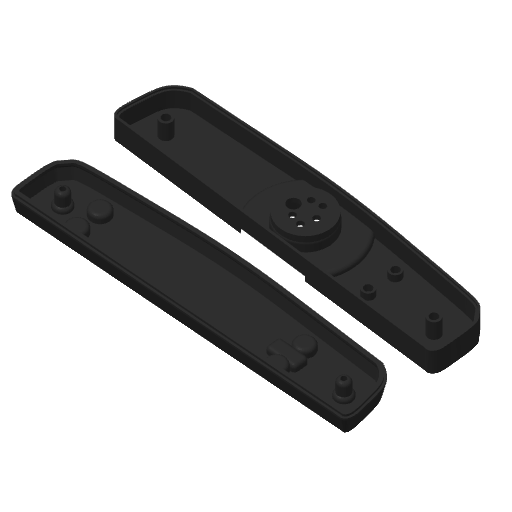
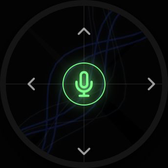
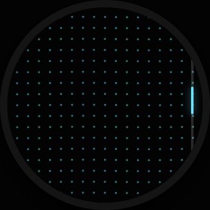
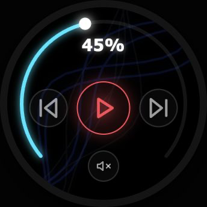
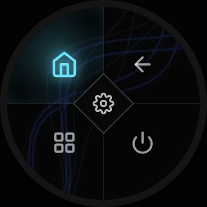
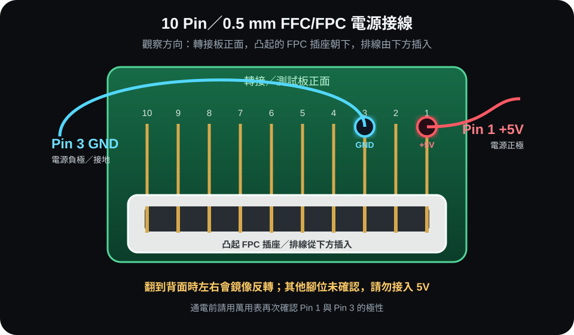
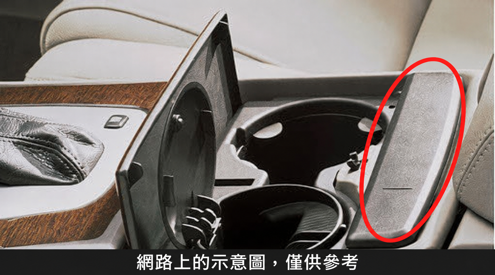

# XC90 智慧車用旋鈕

以 ESP32-S3 為核心的車用藍牙控制旋鈕，搭配 1.5 吋、466 × 466 圓形 IPS 觸控螢幕。裝置透過 BLE HID 模擬鍵盤、滑鼠與多媒體控制器，不需在 Android 車機安裝 APK。



## 設計概念

- 實體旋鈕與觸控螢幕各自獨立操作，避免畫面焦點與實體輸入互相干擾。
- 按住旋鈕並轉動切換四個頁面；短按為確認、雙擊為返回、長按為首頁。
- 純黑背景搭配青藍、桃紅、綠色及金色高對比元素，適合車內與夜間使用。
- 60 秒未操作時只關閉螢幕，BLE 維持連線；旋轉、按壓或觸控即可喚醒。
- 外殼依 Volvo XC90 中央區域的長條配置設計，v15 3MF 內含兩個長形模型零件，已取消舊版獨立圓形旋鈕零件。

## 四個操作頁面

<table>
  <tr>
    <td align="center"><br><b>1. 導航</b></td>
    <td align="center"><br><b>2. 觸控板</b></td>
  </tr>
  <tr>
    <td align="center"><br><b>3. 多媒體</b></td>
    <td align="center"><br><b>4. 系統快捷</b></td>
  </tr>
</table>

1. **導航**：順時針送出鍵盤向下鍵，逆時針送出向上鍵；觸控區直接送出方向鍵或語音指令。
2. **觸控板**：旋鈕控制滑鼠滾輪，觸控螢幕模擬滑鼠移動，短按為滑鼠左鍵。
3. **多媒體**：旋鈕控制音量，觸控按鈕提供上一首、播放／暫停、下一首與靜音。
4. **系統快捷**：旋鈕維持鍵盤上下選擇，觸控按鈕提供首頁、返回、多工、休眠及車輛設定快捷鍵。

## 完整硬體清單

### 成品所需

| 項目 | 規格 | 數量 | 備註 |
| --- | --- | ---: | --- |
| 智慧旋鈕主模組 | ESP32-S3、8 MB Flash、8 MB OPI PSRAM | 1 | 主控、藍牙與旋鈕輸入 |
| 圓形觸控螢幕 | 1.5 吋 IPS、466 × 466 | 1 | SH8601 QSPI 顯示、CST816S 電容觸控；通常與主模組整合 |
| 旋轉編碼器 | 無段旋轉、具下壓按鍵 | 1 | 通常與主模組整合 |
| FFC/FPC 排線 | 10 Pin、0.5 mm 間距 | 1 | 現有排線標示 `FPC-ZJFPC-10PIN-3H` |
| FFC/FPC 轉接／測試板 | 10 Pin、0.5 mm 間距 | 1 | 正面凸起式 FPC 插座版本 |
| 5V 電源 | 穩定 5V DC | 1 | 接測試板 Pin 1；額定電流依實際模組需求選擇 |
| 連接線 | 電源正極與接地線 | 各 1 | 建議使用紅色標示 +5V、黑色標示 GND |
| 3D 列印外殼 | `models/xc90-phone-remote-v15.3mf` | 1 組 | 2 個長形模型零件 |
| M3 × 4 mm 螺絲 | M3 | 2 | 外殼組裝 |
| M3 × 12 mm 螺絲 | M3 | 2 | 外殼組裝 |
| M3 熱熔螺母 | M3 | 4 | 壓入列印件 |
| M2.5 × 4 mm 螺絲 | M2.5 | 3 | 模組與模型固定 |
| 原車聽筒磁鐵 | 從原車聽筒拆下後保留 | 4 | 列印到磁鐵槽上方前暫停，放入模型後繼續列印 |

### 開發、燒錄與使用端

| 項目 | 數量 | 用途 |
| --- | ---: | --- |
| 可傳輸資料的 USB 線 | 1 | ESP32-S3 燒錄與序列診斷 |
| 電腦 | 1 | Arduino IDE／arduino-cli 編譯與上傳 |
| 支援 BLE HID 的 Android 車機或手機 | 1 | 配對及按鍵功能測試，不需安裝 APK |
| 萬用表 | 1 | 通電前確認極性、5V 與 GND |
| 烙鐵／熱熔螺母工具 | 1 | 安裝 M3 熱熔螺母 |

## FPC 電源接線

以下方向已依實物確認：**從轉接／測試板正面觀看，凸起的 FPC 插座朝下（排線由下方插入）時，接點由右至左為 Pin 1～Pin 10。**

- **Pin 1：+5V 正極**
- **Pin 3：GND／負極**
- 其他 Pin：本專案未確認，請勿接入 5V



> 翻到轉接板背面觀看時，左右順序會鏡像反轉。務必以「正面、凸起插座朝下」為判斷基準，通電前再用萬用表確認。

## 已確認 GPIO

| 功能 | ESP32-S3 GPIO |
| --- | --- |
| SH8601 CS / CLK | 12 / 10 |
| SH8601 D0 / D1 / D2 / D3 | 13 / 11 / 14 / 9 |
| 顯示 RST / PANEL_EN | 8 / 17 |
| CST816S SDA / SCL | 1 / 3 |
| CST816S RST / INT | 2 / 4 |
| 編碼器 A / B / 按鍵 | 6 / 5 / 0 |
| 狀態 LED | 21 |

GPIO17 必須在 SH8601 初始化之前拉高。

## 專案內容

- [`firmware/smart_car_knob_v1/`](firmware/smart_car_knob_v1/)：ESP32-S3 Arduino 韌體與燒錄腳本。
- [`models/xc90-phone-remote-v15.3mf`](models/xc90-phone-remote-v15.3mf)：v15 兩件式長形外殼模型。
- [`HARDWARE.md`](HARDWARE.md)：硬體與接線資料。
- [`MAKERWORLD.md`](MAKERWORLD.md)：可直接貼到 MakerWorld 的模型介紹。

## 編譯與燒錄

Arduino IDE 選擇 `ESP32S3 Dev Module`：Flash Size 設為 8 MB、PSRAM 設為 OPI PSRAM、USB CDC On Boot 啟用，Partition Scheme 選擇 8M with SPIFFS，並安裝 NimBLE-Arduino 2.x。

開啟 `firmware/smart_car_knob_v1/smart_car_knob_v1.ino` 後即可編譯。建議只燒錄 App 分區，以保留原廠 bootloader、partition table 與 NVS：

```sh
cd firmware/smart_car_knob_v1
./flash_app.sh /dev/cu.usbmodemXXXX
```

詳細資訊請參閱 [`firmware/smart_car_knob_v1/README.md`](firmware/smart_car_knob_v1/README.md)。

## 3D 列印與組裝

3MF 使用毫米為單位，包含兩個長形外殼零件：約 40.81 × 188.24 × 14.00 mm 與 40.81 × 188.24 × 12.00 mm。新版已取消獨立圓形旋鈕零件。



*網路上的示意圖，僅供參考。*

1. 拆下原車長條型聽筒，小心取出並保留其中 4 顆磁鐵。
2. 在切片軟體中，於即將封閉磁鐵槽的那一層之前加入暫停。實際層數會因層高與切片設定而異，請在預覽中確認。
3. 暫停後依原車方向與極性放入 4 顆磁鐵，確認磁鐵與槽位平齊、不會被噴頭碰到，再繼續列印。
4. 完成後使用 M3 與 M2.5 螺絲組裝，正式鎖緊前先以實物試裝。

> 磁鐵極性與朝向必須與原車安裝方式一致。不要直接猜測固定層數；應以本次切片預覽中的磁鐵槽閉合位置設定暫停。

## 專案狀態

韌體已在 ESP32-S3 實機完成顯示、觸控、旋鈕、休眠喚醒與燒錄測試。BLE HID 的最終相容性仍會受 Android 車機的藍牙堆疊與按鍵映射影響，建議在目標車機完成配對驗證。
